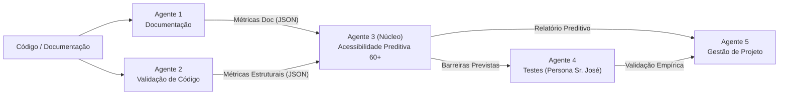

# Ergane — Ecossistema e Agentes de Software

> **Projeto:** Plataforma para Pequenos Empreendedores (CNPJ / MEI / ME / EPP)  
> **ODS Escolhida:** ODS 10 — Redução das Desigualdades (Foco em Inclusão Digital 60+)  
> **Curso:** Graduação em Engenharia de Software — UniCesumar  
> **Disciplinas:** Arquitetura de Software · Gestão de Projetos · Tecnologias Emergentes  
> **Entrega Individual (Entrega 2):** [Agente 3 — Acessibilidade Preditiva 60+ (README Dedicado)](file:///home/caua/Desktop/ergane/README_AGENTE3.md) — Aluno: Caua Cesar da Silva de Oliveira

> [!TIP]
> **Para executar diretamente a Entrega do Agente 3 (Acessibilidade 60+):**  
> `python3 agente3_cli.py analyze sample_ergane_module.py` ou `python3 agente3_cli.py test`  
> Documentação completa em: [README_AGENTE3.md](file:///home/caua/Desktop/ergane/README_AGENTE3.md)

---

## 1. Visão Geral e Contexto (ODS 10)

O **Ergane** é uma plataforma voltada a micro e pequenos empreendedores que atuam com CNPJ (MEI, ME e EPP), simplificando tarefas como controle de caixa, emissão de recibos, cobranças via PIX e organização de pedidos. 

A **ODS 10 (Redução das Desigualdades)** é o pilar central da solução: o ecossistema prioriza a inclusão digital de empreendedores com mais de 60 anos (economia prateada), garantindo que clareza de linguagem, legibilidade e acessibilidade preventiva sejam requisitos fundamentais de funcionamento antes mesmo da tela chegar ao usuário final.

---

## 2. Fluxo e Orquestração dos 5 Agentes

Os cinco agentes de software cooperam de forma desacoplada através de um **Barramento de Eventos (EventBus / Padrão Observer)** e uma arquitetura em **Pipe-and-Filter**:



---

## 3. Especificação dos Agentes e Padrões de Projeto

| # | Agente | Papel no Ecossistema | Padrões GoF & GRASP | Estilo Arquitetural |
|---|---|---|---|---|
| **1** | **Agente de Documentação de Software** | Extrai métricas (cobertura docstrings, índice Flesch, jargões, nomes) e gera Guia de Erros em linguagem simples para idosos (≥ 8 tipos). | **Factory Method**, **Adapter**, **Template Method**, Especialista + Baixo Acoplamento | Pipe-and-filter |
| **2** | **Agente de Validação de Código** | Análise estática (sintaxe, qualidade, segurança) e extração de métricas estruturais (CC, tags semânticas, consistência, erros problemáticos, LOC). | **Factory Method**, **Composite**, **Strategy**, Polimorfismo + Baixo Acoplamento | Pipe-and-filter |
| **3** | **Agente de Acessibilidade Preditiva (Núcleo)** | Cruza métricas dos Agentes 1 e 2 com regras 60+ nas 4 frentes (Percepção, Operação, Compreensão e Fluxo) para prever barreiras front-end. | **Factory Method**, **Decorator**, **Observer**, Especialista + Controlador | Orientado a Eventos / MVC Adaptado |
| **4** | **Agente de Testes Automatizados** | Simula a persona do usuário idoso (**Sr. José**, zoom 200%, teclado, pausas) medindo tempo de recuperação de erros técnicos (≤60s) e financeiros (≤90s). | **Builder**, **Facade**, **Strategy**, Controlador + Baixo Acoplamento | Pipe-and-filter com retorno |
| **5** | **Agente de Gestão de Projeto** | Calcula velocity e burndown, emite alertas de risco para tarefas 60+ e prioriza automaticamente erros financeiros na sprint. | **Factory Method**, **Adapter**, **Observer**, Especialista + Controlador | Pipe-and-filter / MVC Adaptado |

---

## 4. Escolha e Justificativa do Harness

O harness adotado para o ecossistema é composto por dois módulos dedicados em `ergane_agents/harness/`:

1. **`ErganePipelineOrchestrator`**:
   - **Por que é o mais adequado?** Conecta com precisão o fluxo determinístico e orientado a eventos exigido pela especificação acadêmica, permitindo que cada agente seja executado de forma independente (testabilidade isolada) ou encadeado em pipeline de ponta a ponta sem dependências externas pesadas.
   - Suporta arquitetura híbrida com **fallback gracioso**: caso o modelo LLM local (Ollama / Llama 3.2 3B) não esteja ativo, o ecossistema opera 100% de forma determinística sem qualquer interrupção.
   - Persiste automaticamente artefatos estruturados em formato JSON e relatórios em Markdown na pasta `output/`.

2. **`ErganeTestHarness`**:
   - Executa uma bateria automatizada de **24 asserções formais** correspondentes a **100% dos critérios de aceitação da Entrega 2** estabelecidos no documento do projeto.
   - Fornece um *Scorecard* transparente com taxas de acerto e conformidade de tempo (≤ 30s por agente).

---

## 5. Como Executar

### 5.1. Execução do Pipeline Completo

Para analisar um arquivo de código e disparar os 5 agentes:
```bash
python3 ergane_cli.py run-all
```
Ou especificando um arquivo de código customizado:
```bash
python3 ergane_cli.py run-all -f sample_ergane_module.py -o ./output
```

### 5.2. Execução do Test Harness (Validação dos Critérios de Aceitação)

Para rodar a verificação dos 24 critérios de aceitação:
```bash
python3 ergane_cli.py test-harness
```

### 5.3. Execução dos Testes Automatizados via `unittest`

```bash
python3 -m unittest discover -s tests
```

### 5.4. Exportação do Guia de Erros 60+

```bash
python3 ergane_cli.py guia-erros
```

---

## 6. Estrutura do Projeto

```
ergane/
├── AEP_ESOFT_Entrega1_Ergane_no_template...pdf  # Especificação original
├── ergane_cli.py                                # CLI e Ponto de Entrada principal
├── sample_ergane_module.py                      # Módulo de exemplo do checkout Ergane
├── requirements.txt                             # Dependências do projeto
├── README.md                                    # Documentação do ecossistema
├── config/
│   ├── settings.yaml                            # Configurações gerais (pipeline, LLM)
│   └── rules_60plus.yaml                        # Regras de acessibilidade 60+ (WCAG)
├── ergane_agents/
│   ├── shared/                                  # Infraestrutura compartilhada
│   │   ├── models.py                            # Dataclasses tipadas (DocMetrics, etc.)
│   │   ├── event_bus.py                         # EventBus thread-safe (Observer)
│   │   ├── base_agent.py                        # Classe base abstrata BaseAgent
│   │   ├── llm_client.py                        # Wrapper Ollama com fallback
│   │   └── utils.py                             # Utilitários JSON/YAML
│   ├── agent1_documentacao/                     # Agente 1 (Documentação & Guia)
│   │   ├── extractors.py                        # Factory Method + Adapter AST
│   │   ├── metrics.py                           # Flesch, jargões, nomes, cobertura
│   │   ├── guide_generator.py                   # Template Method (Guia 8+ erros)
│   │   └── agent.py                             # Classe AgenteDocumentacao
│   ├── agent2_validacao/                        # Agente 2 (Validação de Código)
│   │   ├── validators.py                        # Composite + Strategy de validação
│   │   ├── structural_metrics.py                # CC, tags semânticas, erros problemáticos
│   │   └── agent.py                             # Classe AgenteValidacao
│   ├── agent3_acessibilidade/                   # Agente 3 (Acessibilidade Preditiva)
│   │   ├── predictors.py                        # Factory Method + Decorator nas 4 frentes
│   │   ├── engine.py                            # Motor de predição e View Markdown
│   │   └── agent.py                             # Classe AgenteAcessibilidade
│   ├── agent4_testes/                           # Agente 4 (Testes Automatizados)
│   │   ├── persona.py                           # Persona Sr. José (68 anos, zoom 200%)
│   │   ├── scenarios.py                         # Builder (5 casos técnicos + 5 financeiros)
│   │   ├── simulation.py                        # Facade + Strategy de medição
│   │   └── agent.py                             # Classe AgenteTestes
│   ├── agent5_gestao/                           # Agente 5 (Gestão de Projeto)
│   │   ├── adapters.py                          # Adapter de issues/backlog
│   │   ├── metrics.py                           # Velocity, Burndown, priorização financeira
│   │   ├── reports.py                           # Factory Method de relatórios Markdown
│   │   └── agent.py                             # Classe AgenteGestao
│   └── harness/                                 # Harness do Ecossistema
│       ├── orchestrator.py                      # Pipeline Orchestrator sequencial/eventos
│       └── test_harness.py                      # Test Harness e Scorecard de aceitação
├── output/                                      # Artefatos e relatórios gerados
│   ├── guia_erros_60plus.md                     # Guia de erros para idosos
│   ├── relatorio_acessibilidade_*.md            # Relatório preditivo 60+
│   ├── relatorio_testes_*.md                    # Relatório dos testes do Sr. José
│   ├── relatorio_gestao_projeto.md              # Backlog priorizado e Burndown
│   └── ergane_metricas_*.json                   # JSON consolidado de métricas
└── tests/
    └── test_ergane_ecosystem.py                 # Testes unitários padrão
```

---

## 7. Critérios de Aceitação da Entrega 2 — Scorecard

| Agente | Critério Especificado | Status |
|---|---|:---:|
| **Agente 1** | Calcular cobertura de docstrings por arquivo | ✅ **100% Aprovado** |
| **Agente 1** | Calcular índice Flesch da documentação | ✅ **100% Aprovado** |
| **Agente 1** | Detectar jargão técnico em docstrings | ✅ **100% Aprovado** |
| **Agente 1** | Gerar JSON de métricas consumível pelos demais agentes | ✅ **100% Aprovado** |
| **Agente 1** | Gerar guia de erros com pelo menos 8 tipos | ✅ **100% Aprovado** |
| **Agente 2** | Extrair complexidade ciclomática por função | ✅ **100% Aprovado** |
| **Agente 2** | Extrair consistência de nomes de componentes front-end | ✅ **100% Aprovado** |
| **Agente 2** | Detectar mensagens de erro problemáticas | ✅ **100% Aprovado** |
| **Agente 2** | Gerar JSON de métricas estruturais | ✅ **100% Aprovado** |
| **Agente 2** | Tempo de análise ≤ 30 s por arquivo de até 500 linhas | ✅ **100% Aprovado** |
| **Agente 3** | Cruzar métricas de documentação e estruturais com regras 60+ | ✅ **100% Aprovado** |
| **Agente 3** | Prever pelo menos 4 categorias/tipos de barreira | ✅ **100% Aprovado** |
| **Agente 3** | Gerar relatório por arquivo e por tela | ✅ **100% Aprovado** |
| **Agente 3** | Emitir sugestão de correção para cada barreira | ✅ **100% Aprovado** |
| **Agente 3** | Tempo de análise ≤ 30 s por arquivo | ✅ **100% Aprovado** |
| **Agente 4** | Simular pelo menos 5 casos de erro técnico e 5 financeiros | ✅ **100% Aprovado** |
| **Agente 4** | Simular perfil idoso com zoom 200%, teclado e pausas maiores | ✅ **100% Aprovado** |
| **Agente 4** | Medir tempo de recuperação por caso | ✅ **100% Aprovado** |
| **Agente 4** | Comparar com meta de ≤ 60 s técnico e ≤ 90 s financeiro | ✅ **100% Aprovado** |
| **Agente 4** | Reportar taxa de acerto das predições do Agente 3 | ✅ **100% Aprovado** |
| **Agente 5** | Gerar relatório de progresso em ≤ 30 s | ✅ **100% Aprovado** |
| **Agente 5** | Calcular velocity e burndown com precisão | ✅ **100% Aprovado** |
| **Agente 5** | Emitir alerta para tarefas de acessibilidade 60+ em risco | ✅ **100% Aprovado** |
| **Agente 5** | Priorizar automaticamente issues de erro financeiro | ✅ **100% Aprovado** |
